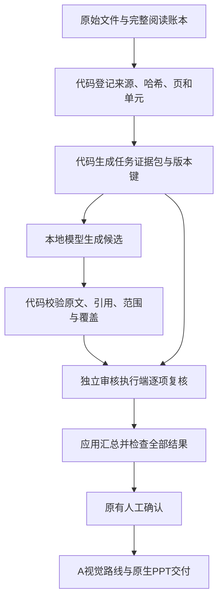

# 上下文减重与本地执行改造计划及评估

**历史计划（2026-10-04起）：** 用户已放弃本地模型。本文件的测量和实验设计保留；本地模型接入、资格实验及放量任务取消，后续实施以[THREE_PATH_EXECUTION_PLAN.md](THREE_PATH_EXECUTION_PLAN.md)为准。代码去重、缓存、覆盖与确定性调度继续推进。

日期：2026-10-03。范围：FactDeck `/api/deck` 主线。状态：计划与离线评估完成；M0审核覆盖及M1可选无损输入格式已写入代码，详见[CONTEXT_IMPLEMENTATION.md](CONTEXT_IMPLEMENTATION.md)。本地生产worker及自动路由尚未接入，同章实测正在进行。

## 1. 目标与判断

减少同一原文、任务规则、工作流状态和执行历史被反复传给模型；把文件准备、重复检测、引用定位、校验、重传和缓存恢复交给本地代码，把可验证的转录和事实选择候选交给本地模型。

当前最值得先做的是合同覆盖检查、证据去重和执行器。单纯把审核切成更多小任务会缩短单次上下文，但可能增加总体输入。现有Bonsai27B能运行文本和视觉候选，尚未证明整章总结、正式独立审核或高并发能力。

本计划保留全文覆盖、逐字事实、独立复读/审核、来源和内容版本绑定、人工确认、A原生矢量视觉路线、实际工具回执及PowerPoint交付核对。生产状态仍由应用验收，SQLite继续管理领取事务。

## 2. 本轮证据与测量

### 2.1 检查的当前代码

- `app/deckflow.py::brief`：SUMMARY将页面正文、页面单元正文和论断文本一起传输；SUMMARY_REVIEW在每条关键要点、提纲要点及关系内展开论断和来源正文。
- `app/deckflow.py::accept_summary_review`：逐点必填验收覆盖`point_coverage`；普通提纲的`key_points`缺少对应必填槽。
- `tools/codex_worker.py`：已有独立领取文件、租约和可选`complete/asset --compact`短回执。应复用它，不重新实现领取或改写`data/projects.json`。
- `tools/visual_worker_runtime.py`：已有续约、期限与并发锁基础；语义候选执行器可复用生命周期设计。
- `app/semantic_model.py`：已有另一套语义模型资格/最小外发合同。可以复用配置思想，但不能直接把其资格解释为全部FactDeck worker任务已获资格。

### 2.2 无损去重实测

使用已存档的两个真实任务，比较同一份`brief`按统一紧凑JSON序列化的大小。去重只共享完全相同的长字符串，保留所有数组条目、来源编号、字词、数字、符号、作用域、规则及结果合同。没有删节原文、只选命中段或用模型摘要替代证据。

| 项目 | 原brief UTF-8字节 | 去重后字节 | 减少 |
|---|---:|---:|---:|
| SUMMARY | 3,012,244 | 2,186,420 | 27.42% |
| SUMMARY_REVIEW | 227,825 | 179,083 | 21.39% |

原任务文件分别为4,161,126和271,796字节，含缩进及领取元数据；上表只比较模型输入brief，避免把格式压缩或删除租约误算为证据去重收益。

SUMMARY正文对象出现2,239次，有2,002个独立编号，同编号重复正文约813,256字节；审核正文对象出现83次，有65个独立编号，同编号重复正文48,221字节。此前“75次/57单元”的统计只覆盖要点证据；本次遍历完整brief，也包括其余正文对象，因此计数口径不同。

两个去重包都解码还原为原始对象，规范化SHA256一致。专项检查通过：来源ID保留、比较符号不同的文字不合并、引用缺失时报错、保留键冲突时报错。打包及验证分别约0.37秒和0.02秒，属于本轮运行测量。

这里测的是字节与字符，不是厂商计费token、模型理解质量或整体费用节省。共享字符串需要明确的执行端支持；单纯JSON压缩、ZIP或只发编号，不会自动让云端模型取得原文。模型仍需收到本次使用的实际证据。

### 2.3 按章拆分的反例

将同一审核分成8个包，每包保留本章全部证据及相同公共规则、总总结、未决问题、资料性质和章节结果合同，再在包内去重：

- 最大单包42,707字节，比原完整审核单包小81.25%。
- 8包总计235,635字节，比原未去重完整审核**增加3.43%**。
- 比一个去重完整审核包增加31.58%。

结论：拆分有利于容纳上下文、缩小失败重试范围，但不能单独作为降低总输入的依据。章节间共享证据和公共说明会被重新传输；仍需测聚合审核、补充证据和重试后的总量。此试验尚未证明跨章总结质量。

### 2.4 本地模型证据

见`LOCAL_MODEL_BENCHMARK.md`及`output/local_model_eval`，本轮已复查真实响应与资源记录：

- 23次请求约149.46秒；输出中位23.12token/秒；显存最高采样7,061MiB。
- 16/16短证据判定标签与作者暂定标签一致，但至少有方向解释错误和漏指出核心差异，不能授予正式审核资格。
- 4条摘录严格合同通过2条；代码唯一空白匹配恢复后通过3条。剩余1条多摘了未要求的分支，原文存在性校验不能解决。
- 18个指定图表格16格完全一致；另外2格把药名并入剂量。没有测完整页覆盖或全部箭头。
- 10/23输出只因代码块包装不能直接解析；代码去除完整外层包装即可解析，无需再次询问模型。
- 运行中系统可用内存最低采样6.14MiB；当时还有其他软件，不能将全部压力归因于模型。本机先采用单实例排队，新增并行须另测。

以上是小样本筛选证据。整章SUMMARY、CLAIMS类型、DECK设计、长上下文稳定性与生产正式审核仍是未验证项。

## 3. 目标执行结构

每次模型任务只接收当前阶段所需的公共规则、目标对象、实际证据和结果合同。项目源文件与完整状态存在本地；协调模型接收状态编号、失败类别和产物位置。模型需要更多语境时，通过代码补充指定原单元、相邻段落、整页或原图，记录实际补充输入量。

全文覆盖账本始终包含全部页和正文对象。原文完整阅读与候选提取完成后，后续阶段可以按引用选证据；检索命中不能用来宣称未读页已被处理。跨章矛盾、总总结和未决问题必须有单独聚合复核任务，不能在分章时消失。

## 4. 任务分工

| 工作 | 本地代码 | 本地模型 | 云端或人工 |
|---|---|---|---|
| 导入、全文覆盖 | 页清单、哈希、文本层、原图渲染、遗漏检测 | 原图阅读/逐格转录候选 | 不清楚的原图和疑难格 |
| 重复内容 | 完全一致字符串共享；来源保留；缓存命中；不自动合并近似事实 | 必要时提示近似内容候选 | 裁定跨来源差异和冲突 |
| CLAIMS/FACTS | 原文偏移、引用存在性、作用域和数字差异提示 | 选择跨度、类型和事实候选 | 类型/范围疑难项及独立复核 |
| SUMMARY | 分章账本、引用解析、重复证据包、聚合清单 | 分章草稿，待扩大测试 | 现有正式独立复核、人工确认 |
| SUMMARY_REVIEW/SEMANTIC_REVIEW | 必填目标槽、证据包、版本/身份/覆盖验收 | 预检查或资格实验 | 当前正式审核仍逐项独立完成 |
| 租约、提交、恢复 | 心跳、短回执、幂等重传、状态查询、产物复用 | 无需判断程序性步骤 | 真实内容错误的处置 |
| A路线视觉与交付 | 内容锁、缓存、几何和文字检查、原生导出/Office队列 | 布局候选需另评估 | 保留Codex＋Adobe实际工具与视觉检查 |

模型用来理解新目标或不确定差异；相同任务重复提交、相同文件重复解析、格式包装、已成功资产重新下载等由代码处理。局部失败只重传或重做失败步骤，不重新阅读全部资料或再次生成已存档成功资产。

## 5. 缓存与证据合同

### 5.1 两类缓存

1. **来源/程序缓存**：文件SHA256、页码、提取器与渲染器版本、参数。相同文件可共享解析结果，但项目登记、来源编号、位置及用户权限仍分别保留。相似但不同文件不靠标题或模型判断复用。
2. **模型候选/任务缓存**：任务类型、完整输入SHA256、目标ID、全部证据哈希、规则/提示词/schema版本、模型权重与投影哈希、推理参数、角色及独立性记录。只在这些条件一致时复用原候选及原调用记录。

不把候选缓存当成验收缓存。复用前重新验证当前内容版本、来源有效性、租约、原文及结果合同。内容、提纲、引用、作用域、规则、解析器或模型变更时使相应缓存失效；既有客户/人工确认仍依原机制失效。

### 5.2 独立审核隔离

- SECOND_READ输入继续隐藏第一次文字和截取框；缓存索引不得泄露初读答案。
- 审核不得复用作者的判定、作者自我解释或初读缓存作为独立结果。审核缓存保留真正的原审核者与版本，不通过换worker名字取得独立身份。
- 作者/审核者的执行身份和资格在应用端检查；本地模型能力按任务范围登记，小样本不自动升级为正式审核资格。
- 对同一原文的多个来源编号只共享存储文本，所有引用及来源性质分别保留，避免多来源被合并成一个“共识”。

### 5.3 新证据包

计划定义版本化包：`original_input_sha256`、`packet_sha256`、目标账本、来源/单元/论断映射、逐字文本、资料性质、必要邻域及结果schema。业务原输入哈希仍绑定原工作流；传输哈希单独计算，不能用去重包哈希替代现有业务哈希。

首版保留完整证据文字，只共享重复正文。引文offset模式和缩小邻域留在第二阶段：只有字符位置唯一、条件/脚注/行列头/相邻连接完整可证明时使用。模型摘要不能替代原件证据。引用缺失、查不到位置、作用域不清或邻域不足时，补回完整原单元/原页并计入总成本。

默认一个任务一次候选调用；程序性包装修复和唯一空白匹配不调用模型。真实内容失败最多一次有针对性的候选修订，随后进入云端/人工异常处理。所有失败尝试保留，不能为节省数字隐藏重试或跳过目标。生产重试上限仍服从原任务机制。

## 6. 分阶段改造与验收

以下为单名开发者的工作量估计，非已测耗时；合计约7–11个开发工作日，独立题集标注、实际审核和长负载观察可能增加日历时间。

| 阶段 | 预计工作量 | 实施位置与产物 | 验收与进入下一阶段条件 |
|---|---:|---|---|
| M0 覆盖与观测 | 1–2天 | 为key_points定义绑定总结版本的稳定目标ID，扩展brief/result合同及accept验收；加入分阶段输入/输出、补证据、重试/回退指标 | 67个关键要点均有必填槽；缺1项、重复ID、旧版本或作者自审均拒绝；结构化提纲与历史状态有明确兼容/失效处理 |
| M1 证据包与本地执行 | 2–3天 | 新增证据包适配模块与worker可选输入格式；原领取/提交不变；短回执、心跳、内容缓存与恢复；先支持SUMMARY_REVIEW和SUMMARY | 原始对象可完整还原；数字/符号/来源/规则不变；无孤立引用；缺证据拒绝；实际总token与补证据次数记录齐全；关闭开关可回到原brief |
| M2 本地候选执行器 | 2–3天 | 新增本地worker命令；复用codex_worker传输及本机兼容接口；单GPU队列；转录/FACTS候选优先，CLAIMS按能力另登记 | 不自动审批；原文、字段、作用域与全文覆盖验证；失败分流；已成功调用只重传；独立复读隔离；资源不足能恢复/排队，不能静默漏页 |
| M3 扩大评估与放量 | 2–3天 | 冻结留出题集、同批旧/新流程对照、来源覆盖及资源报告；分章SUMMARY/DECK候选在此另测 | 满足下文质量、成本与运行门槛后，仅开放通过的任务类型；保留正式审核及原视觉主线 |

M0是审核拆分和正式采用新合同的前置。独立必填槽的修订只增加覆盖保证，不由模型自动填写“通过”；历史任务需版本化迁移，不能给旧审核补造67个判定。

优先复用当前测试`tests/test_deckflow.py`、`tests/test_parallel_visual_workers.py`的有效版本、身份、租约及兼容场景；补充无损证据包、缓存失效、缺项/重复项和本地候选范围错误测试。未经改造的legacy语义端点仍沿用其旧合同和 safeguards。

## 7. 评估设计与放量门槛

### 7.1 对照组

- A：现有brief及执行方式。
- B：同一模型、同一内容，使用共享证据包及代码执行，衡量上下文改造的独立收益。
- C：B加本地转录/摘录候选及程序验收，正式独立审核仍按原要求完成，衡量候选路由的增量收益。

原始来源、要点、目标范围、引用和人工关口在各组一致。跨章聚合审核、邻域补充、失败重试和所有回退计入总输入与历时；拆成小包不从账单中消失。云端实际usage若接口不可取得，记录可测输入字符/字节并明确token未知，不拿本地tokenizer推算云端账单。

### 7.2 题集与质量

先冻结至少100个信息忠实度样本，覆盖比较符号、范围、且/或、否定、剂量/单位、人群、时间、限制、表格行列头和箭头；另选至少10个完整图表页及2个密集章节，包含扫描、中文、多栏及脚注。预期由独立审核者按原件标注；隐藏作者答案；冻结后才运行，不用事后调整rubric制造通过率。

指标分别报告，不混成一个“准确率”：逐字合法性、数字/单位/符号错误、条件/否定遗漏、范围扩大、格位/箭头方向、完整页覆盖、判定及理由正确性、严重错误漏检、全流程返工量。

- 证据包：全体来源引用/目标账本完整；可逆阶段还原一致；来源冲突和不清楚内容不能被压缩掩盖。
- 关键事实：放量样本内数字、单位、比较符号、否定和方向错误不得进入被程序接受的结果；发现时阻断并保留失败。
- 候选能力：必须结合回退比例和最终返工量，才决定是否值得开放；通过的只登记对应样本覆盖的任务/版面范围。
- 正式审核：继续独立覆盖全部要点；未获专门资格前，本地预判不能跳过云端/独立审核目标。

### 7.3 成本与运行

M1的建议试运行目标是：SUMMARY_REVIEW总输入token至少降低15%，SUMMARY至少降低20%，且补证据/重试后的总量仍达标；这是目标，不是本轮已取得的token结论。若达不到但上下文峰值明显降低，只能以容量改善立项，不能宣称降费。

新增记录：请求输入/输出token及可用cached token字段、原文/重复/元数据字节、模型调用数、格式修复数、语义重试/补证据数、缓存命中、云端回退、模型/GPU/Office时间、人工复核时间、显存/RAM最低余量、任务结果及版本。输入token、文件字节、GPU秒、人时分别记账。

本地部署先测30分钟持续串行负载、进程重启恢复、缓存命中和同机Office竞争；记录请求延迟分位数、可用RAM和换页情况。未测出稳定余量前限制为一个本地推理槽，不能按本轮短样本估算SaaS并发容量。

总成本模型：云端输入/输出及工具实际费用＋本地GPU/电耗/设备摊销＋重试/回退＋人工复核。真实单价未知时只报告调用和资源量。不要从单项字节减少21.39%推导整套课件费用也降低21.39%。

## 8. 风险、处置和回退

| 风险 | 处置 |
|---|---|
| 共享编号让模型找不到证据 | 任务包内提供实际使用文本；引用缺失报错；对照模型理解后才启用 |
| 摘句失去脚注/否定/行列条件 | 首版全原单元；后续邻域缩减单独测；歧义补整页 |
| 拆分漏掉全局关系或重复传输增加 | 保留聚合任务和完整账本；按总调用输入衡量 |
| 缓存用错版本或破坏独立性 | 全版本键＋角色隔离＋重新验收；旧审核不自动迁移 |
| 本地输出格式正确但语义范围错误 | 字符串验收之外检查作用域；正式独立审核保留 |
| 16GB机器内存紧张 | 单实例队列、实际RAM基线、负载门槛、失败恢复；模型和Office分开调度 |
| 功能复杂度超过节省收益 | M1先衡量再进入M2；没有整体收益就保留原模式 |

接入以worker侧可关闭的格式/路由开关放量。回退使用原brief和原执行端；原事实、任务输入哈希、已通过确认和实际工具回执不重写。已成功资产/代码结果优先验证复用，内容变化则沿既有失效机制重做。

## 9. 本轮交付与完成范围

已完成：当前代码检查、两个真实任务的无损去重原型、章节拆分总量反例、可逆及关键差异专项检查、现有Bonsai实测证据复核、按阶段实施计划与放量/回退标准。

存档：`output/context_assessment/assessment.json`包含来源文件哈希、原/新大小、逐章数据和验证结果；`SUMMARY_packed.json`、`SUMMARY_REVIEW_packed.json`及8个章节包是离线候选输入，不是已被生产任务认可的合同。复现入口：`python -X utf8 tools/context_payload_assessment.py`。

上述为计划阶段的原交付记录。后续已实现审核覆盖合同和可关闭共享输入格式，并启动S03同章对照，见[CONTEXT_IMPLEMENTATION.md](CONTEXT_IMPLEMENTATION.md)。仍未实现生产本地worker、真实云端token计费采集、大留出集资格验证和自动流程路由切换；这些不得标为已完成。
