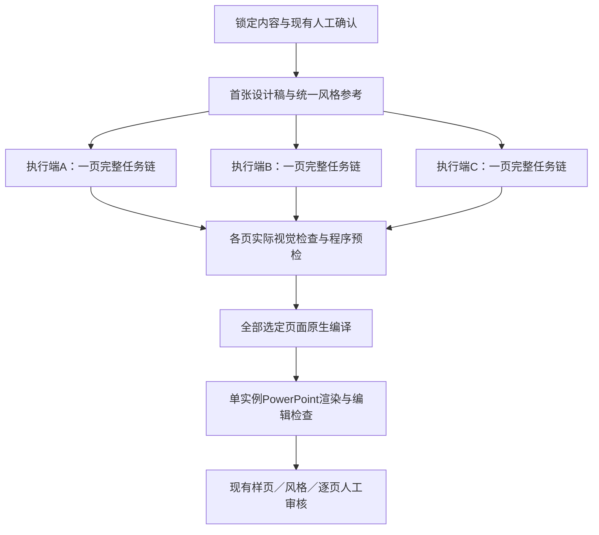

# FactDeck 并行执行与效率改进方案

状态：2026-10-02 已实施执行支持，并用于前15页剩余工作的3端并行运行；最终产物及实测结论见 `output/live15_generation/final/report.md`（完成后生成）。保留原人工审核关口。

## 2026-10-13 吞吐改进（去掉往返，返工前移）

依据第一批五页的实测：每页约8.5分钟，其中真实工具约2分钟、版面约1分钟，其余是执行端每步的领取、读合同、手写回执和提交。确认规则、真实调用回执和人工关口不变。

| 改进 | 实现 |
|---|---|
| 回执自动生成 | `codex_worker.py submit`：执行端只给实际文件、调用标识、耗时和检查结论；合同校验值、完整提示词、参考资产校验值和文件校验值由程序填入。去字的“无残字/已移除语义图形”须执行端显式声明，程序不代为声明 |
| 提交即续领 | `submit/layout --next-out`：同页下一步直接租给同一执行端，并把参考资产（本机存档按校验值复制）放到合同旁；`--next-kinds` 限定分工 |
| 合同适配工具 | 合同列出 `allowed_tools`；去字只用 ImageGen（Adobe 去字实测保留页脚）；去字提示词≤1500字，区域坐标改为结构化 `regions` |
| 默认版面 | `codex_worker.py layout --inspected [--patch]`：版面默认等于内容锁几何，执行端看过设计稿后确认或只改个别对象 |
| 版面预检 | 提交版面时运行与最终导出相同的浏览器溢出/重叠检查（不通过即拒绝，未花去字和矢量调用），并按设计稿检查文字对比度 |
| 单页预览 | 矢量化提交后自动单页编译（浏览器、原生PPTX、PowerPoint），附对比度、原生色块遮挡插画、插画容器超出原生色块的信号；`page-preview` 可手动触发。只是预览，不绑定审核，整套导出关口不变 |
| 按批次排队 | 同时在制默认5页（`generate --batch-size N`），前面完成再排后面；从未领取的窗口外任务撤回，不再整套作废 |
| 矢量检查 | `tools/vector_preview.py`：去字稿｜Chromium 渲染的 SVG｜原生转换三联图。通用 SVG 预览器不支持渐变时会把渐变路径画成黑色，不能据此判定矢量缺陷 |
| 实测计时 | `tools/visual_batch_timing.py FLOW_ID --since UTC时间`：按任务时间戳和回执逐页给出墙钟、工具耗时、等待和重试；领取时记录 `claimed_at` |

### 双执行端分工（ImageGen 串行是硬瓶颈）

```powershell
# 生图端：只做设计稿和去字
python tools/codex_worker.py claim FLOW_ID --worker Codex-imagegen --kinds VISUAL_DESIGN VISUAL_CLEAN --out W1/task.json --assets-dir W1/assets
python tools/codex_worker.py submit FLOW_ID --task W1/task.json --file ACTUAL.png --tool-call-id CALL_ID --elapsed 57.8 --inspected --qa-note "检查结论" [--text-free --semantic-removed]
# 版面/矢量端：确认版面、Adobe 矢量化、查看三联图
python tools/codex_worker.py claim FLOW_ID --worker Codex-vector --kinds VISUAL_LAYOUT VISUAL_VECTOR --out W2/task.json --assets-dir W2/assets
python tools/codex_worker.py layout FLOW_ID --task W2/task.json --inspected [--patch patch.json] --next-out W2/next.json --next-kinds VISUAL_LAYOUT VISUAL_VECTOR
python tools/vector_preview.py --svg ACTUAL.svg --clean W2/assets/clean.png --out W2/vector_check.png --task W2/task.json
python tools/codex_worker.py submit FLOW_ID --task W2/task.json --file ACTUAL.svg --tool-call-id CALL_ID --elapsed 10.3 --inspected --qa-note "检查结论"
python tools/codex_worker.py generation FLOW_ID   # 查看各页 preflight / preview 信号
```

两端身份不同、任务文件和资产目录分开；一页的阶段顺序不变。生图端连续处理多页的设计和去字，版面/矢量端同时处理已出图的页，两端互不等待。


- 领取接口和 `codex_worker.py claim` 增加可选 `binding`，在原 SQLite 领取事务内选择指定页面；旧调用行为兼容。
- `asset` / `complete` 增加可选 `compact`，执行端收到任务编号、状态及校验值的简短回执。默认完整响应及旧流程不变。
- `tools/visual_worker_runtime.py` 提供独立90秒续约、唯一日志/停止文件和 SQLite 工具并发锁。当前 ImageGen 1、Adobe 2、浏览器 1；PowerPoint仍串行。
- 任务完成、失效或停止文件出现时心跳退出；网络中断可重试，默认最多运行1小时，可设为最多2小时。尚无agent进程死亡的即时检测，孤儿心跳由明确时限收敛，工具锁由到期回收。
- 协调端在本会话向3个页面agent分配明确页面；各端一页一个有效租约，独立目录，完成整页后接下一页。尚未实现服务器自行发现agent并投递任务。
- 原生表格支持受约束的字体、字号、行距、列宽和行高。全部单元格文字、格式角色和来源保持锁定；拒绝替换内容。
- 浏览器预检修正单元格父级字体度量，检查表格及行实际扩高、表格与文字相交，并禁止文字框自动扩高进入表格。
- 并行领取/旧token拒绝/工具限额/简短回执及主线、表格合同47项测试通过；另4项真实浏览器/字体度量回归测试通过。测试夹具不是工具调用证据。
- 实际失败发现去字提示既要求保留表头外框又要求删表，以及卡片被当成表格删除。现已按锁定模型是否存在原生表格分支：表格整块删除补纸色；无表格页面明确保留卡片外框、标题色带和非文字图标。专项合同回归通过；失败调用与画面保留。
- 实际PowerPoint检查修正A路线的统一文本框加宽及表格边线XML顺序；文字实际边界由Office测量，不换行文字的小幅安全字形外沿差异单列。导出器版本升级通过原入口复用完整素材重编译，无需再领取模型任务。3项原生几何/边线/安全字体边界测试、1项无新增工具的重编译回归通过。

### 执行端用法

```powershell
python tools/codex_worker.py claim FLOW_ID --binding PAGE_ID --kind VISUAL_CLEAN --worker Codex-visual-A --out data/worker/parallel_A/UNIQUE.json
python tools/visual_worker_runtime.py start FLOW_ID --task data/worker/parallel_A/UNIQUE.json --stop data/worker/parallel_A/UNIQUE.stop --out data/worker/parallel_A/UNIQUE.heartbeat.json
python tools/visual_worker_runtime.py lock --tool image_gen --task data/worker/parallel_A/UNIQUE.json --out data/worker/parallel_A/UNIQUE.lock.json
# 真实工具调用；先存档并查看输出，再提交：
python tools/codex_worker.py asset FLOW_ID --task data/worker/parallel_A/UNIQUE.json --file ACTUAL.png --receipt ACTUAL.receipt.json --compact
python tools/visual_worker_runtime.py unlock --lock data/worker/parallel_A/UNIQUE.lock.json
python tools/visual_worker_runtime.py stop --stop data/worker/parallel_A/UNIQUE.stop
```

`UNIQUE`须随任务租约变化；工具锁等待超时只重试取锁。心跳覆盖工具等待、下载、模型检查和提交全周期。启动后台辅助进程须隐藏窗口。不要使用历史脚本的共享 `claimAny` 文件做并行领取。

## 1. 目标与边界

保留现有 sources → summary → facts → deck → A_NATIVE_VECTOR 主线及全部版本绑定、事实逐字校验、独立语义复核、人工确认和交付审核。A 路线继续为完整设计稿 → 布局拆解 → 去字 → Adobe 实际矢量化 → 原生图形与锁定文字 → PowerPoint 核对。

提高执行吞吐，减少租约空耗、重复调用和人工衔接。模型执行理解、设计及实际视觉检查；程序管理领取、心跳、持久化、校验和导出。

## 2. 当前证据

- `app/fact57098.py` 的领取使用 SQLite `BEGIN IMMEDIATE`，同一任务只有一个有效租约；`LEASE_SECONDS=900`。现有并发领取测试已覆盖同一任务不能被两端同时取得。
- `app/deck_generation.py` 已按页排队四种视觉任务；首张设计稿完成后其余页可独立执行。整套原生编译在所有页资产齐备后启动。
- `output/live15_generation/worker_helpers.js` 的 `claimAny` 对同一任务类型复用同一个临时文件；多个调用并发时存在覆盖风险。不同执行端也必须使用不同的任务文件、资产目录和 worker 身份。
- 该脚本仅在生图等待期间尝试续约；后续模型检查、Adobe、下载、渲染和提交尚无覆盖整个任务生命周期的独立心跳。
- 2026-10-02 的 `data/worker/live15_efficiency_snapshot.json`：114 次任务领取尝试，42 次重试，35 条去重后的已接受工具调用回执。领取尝试不等于生图次数；未提交的调用不在应用计数中。
- 多次去字结果保留表格分隔线、一次 Adobe 连接失败、一次 SVG 下载连接失败均需要分别记录。工具重试、租约恢复和视觉修订不是同一种成本。
- 完成与资产端点返回完整工作流，执行脚本将完整状态反复写盘。应测量响应字节和序列化耗时后改为可选的简短确认响应，旧调用保持兼容。

## 3. 执行结构

采用本会话可用的4个 agent 槽位：1个协调 agent＋3个页面执行 agent。另由程序提供租约心跳与单实例 PowerPoint 导出，不占模型 agent 槽位。

| 角色 | 职责 | 在制上限 |
|---|---|---|
| 协调 agent | 风格基准、任务分配、异常决策、进度汇总、最终实际画面检查及人工审核材料 | 不预领批量页面 |
| 页面执行 agent A/B/C | 一页内依次完成设计、布局、去字、Adobe、真实输出检查与提交 | 每端1页、1个当前租约 |
| 程序心跳与存档 | 90秒续约、检查任务有效性、执行端立即存档真实输出、短暂故障重传 | 有明确 task/token、停止文件和运行时限 |
| 程序原生导出 | 内容回读、逐页预检、整套编译、PowerPoint渲染与编辑验证 | 同一Office会话1个任务 |

前15页执行端使用不同身份，如 `Codex-visual-A/B/C`。输出目录以 generation/page/stage/attempt 组织，领取文件以 worker/task_id 命名，日志与回执追加保存，不能覆盖前一次实际调用记录。

每端拿到一页后及时领取当前步骤，提交成功才推进下一步骤；只有整页完成或需要协调决策时才汇报协调端。协调端无需逐次代为领取、复制文件或提交回执。每端必须实际查看自己提交的真实设计、去字和矢量预览。

## 4. 保留依赖，跨页流水执行



一页中的阶段顺序保持不变，不允许在事实确认前生成正式内容。同一页同一步不得被两个 agent 同时处理。其他页可以同时处于设计、布局、去字或矢量化阶段。

首张风格参考的修订仍按现有机制使相关页面失效。协调端冻结风格后再展开并行；保留现有风格人工审核门槛，不增加一次新的必填确认。

## 5. 调度与资源限制

初始页面并发3；工具并发与 agent 数量分开控制。ImageGen 初始并发1，确认真实完成区间有重叠且没有明显限流后试2；Adobe初始2；浏览器预检初始1；PowerPoint固定1。都应配置化，不因 agent 增多而直接提高。

并行 agent 无法保证同一工具后端并行。调用时间要拆成提交等待、远端执行、下载、模型检查和提交五段；如厂商不返回远端执行时间，标记未知，不把总等待时间当成厂商执行时间。不能承诺3倍提速。

较长工具调用前只取得当前任务租约；心跳由独立的本机辅助进程管理，不依赖模型继续思考。任务已提交、失效或停止文件出现时心跳退出；执行端退出而未写停止文件时，依靠明确运行时限回收，尚未检测agent进程死亡。任务交接后旧 token 不得提交；保留现有15分钟租约和有效 token 校验。

SQLite保留短事务领取和提交；工具调用、SVG解析、浏览器与Office执行在事务外。程序预检可提前按页进行，整套导出只在当前版本所有资产齐备后执行。不得以并行方式直接改 `data/projects.json`。

## 6. 失败与恢复

- 实际工具结果一返回，先保存真实输出路径、工具标识、完整提示词、输入校验值、实际时间与回执；再进行模型检查。
- 租约过期只恢复领取，不自动重新生图。若已存档输出与新任务的完整提示词、输入资产和版本一致，检查后用新租约提交同一真实结果。
- 下载或提交失败，重试下载或提交；不得因此重跑成功的Adobe或ImageGen。
- 视觉检查失败只修订对应页、对应步骤及依赖资产；保存失败画面和原因。不能声明未完成的残字或语义图形清理已通过。
- 增加工具调用意图状态：未调用、已发出、已返回、已检查、已提交。外部结果不明时记录未知；可查询供应商任务时先查，不伪造回执。
- 分别报告工具实际调用重试、网络传输重试、租约恢复、版面修订和人工等待。现有 attempts 保留，新增统计不改变原审核语义。

## 7. 优先实现顺序

1. **修复执行脚本隔离与恢复。** 唯一任务文件和输出命名、整生命周期心跳、真实调用追加存档、任务恢复先查已有素材；去掉提前领取多页的做法。
2. **加入3端页面调度。** 为不同页面分配独立执行端身份；主线领取接口可增加可选 page/binding 筛选，旧参数与旧行为继续兼容。不改变医学语义端点。
3. **减少完整状态传输。** 现有完成和资产端点支持可选简短确认，工作台仍可读取完整状态；执行端仅在需要时获取页面合同或项目状态。
4. **提前做按页预检。** 在去字前完成真实字体和长表格容量检查；在资产提交前完成SVG与原生路径检查，减少导出末尾返工。保留最终整套回读和Office验证。
5. **记录3页并行基准。** 选长文本、表格、流程各1页，测量真实历时、有效并发、租约恢复、工具调用和人工处理时间，再决定工具并发上限。

## 8. 验收标准

- 三个执行端同时工作时，每个 task 只有一个有效租约；不同执行端文件互不覆盖。
- 生图、Adobe和模型检查跨过15分钟仍能正确续约；执行端崩溃后任务可恢复，旧 token 被拒绝。
- 已有成功真实素材不会因租约、下载或提交失败而重复生成。
- 事实原文、数字、单位、限定条件、来源及关系不变；无图片替代原生生成图形。
- 内容作者与独立语义复核身份分离继续成立；所有人工确认和最终交付门槛继续生效。
- 对外展示真实已完成页数、当前阶段及阻塞原因；未完成整套不能显示交付完成。
- 效率结论来自同内容、同工具、同审核要求的实测，不用agent数量推算提速。

## 9. 成本与部署结论

并行主要缩短墙钟等待，不会减少每页固有的生图、去字和矢量化调用；增加agent也有上下文及协调消耗。降低成本首先依靠复用真实成功素材、减少错误重生成和缩短模型上下文。

保持现有Codex＋Adobe执行端时，可先做人工辅助的多执行端生产台。无人值守SaaS仍需另行验证工具授权、后端并发及计费、持久任务查询、账号隔离和Office执行宿主；本方案不宣称已完成这些能力。

前15页所有现有素材和已确认内容继续保留。执行支持已实现，工具调用仍由在线Codex＋Adobe端完成；后端自主agent调度、完整调用意图账本和50页效率基准仍待实现或实测。文档不修改工作流确认或交付状态。
